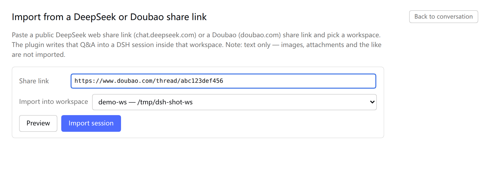

# dsh-share-import

[](https://github.com/Sillykjs/dsh-share-import/actions/workflows/ci.yml)
[](LICENSE)
[](#requirements)

Import a **public chat share link** into [DeepSeek Harness (DSH)](https://github.com/deepseek-ai/dsh) as a
real, resumable session inside a workspace you pick. Supported sources:

- **DeepSeek** — `https://chat.deepseek.com/share/<id>`
- **Doubao (豆包)** — `https://www.doubao.com/thread/<id>` (also without `www`)

The imported conversation is **history only**: no message is sent, nothing is generated, no turn is left
open. Open the session and it is already a finished conversation — your next prompt simply continues from
that history.

[中文说明](README.zh-CN.md)

## Features

- **Zero credentials.** DeepSeek is read through its public share endpoint
  (`https://chat.deepseek.com/api/v0/share/content?share_id=…`). Doubao is read through its public JSON
  snapshot endpoints (regular ids via `POST /alice/message/share/get`, mobile `x…` ids via
  `POST /im/message/share/get`), falling back to the server-rendered share page. No login, no token, no
  headless browser.
- **Pick the target workspace.** The panel lists the workspaces of your DSH instance and writes the session
  into the one you choose.
- **Static import.** Writes a v4 session event log directly: `session/title → turn/start → step/start →
  user/message → assistant/message → step/end → turn/end → session/end-seed`. Nothing is scheduled.
- **Duplicate guard.** Re-importing the same share is blocked by default (`ALREADY_IMPORTED`), with an
  explicit "import as a new session anyway" path in the panel.
- **Bilingual UI.** English and Chinese strings follow the DSH UI language.
- **Optional sidebar entry.** A switch in Settings keeps the nav entry visible or hidden; the state lives in
  `localStorage` of the current browser.
- **Honest limits.** Doubao shares import text only; images and videos have no textual body and become a
  single placeholder line. A share that the page itself declares lazy-loaded is reported as `SHARE_LAZY`
  instead of importing a truncated conversation.

## Screenshot

The import panel, opened from the sidebar entry or from Settings → **Share import**:



## Requirements

- DSH **0.2.1-rc.2** (the version this plugin is written and tested against) with the `web` profile.
- Node.js **≥ 20** on the machine that runs `dsh web`.
- A public share link that is readable without logging in. Private/expired shares cannot be imported.

The host half uses DSH services that are not a stable public API; a DSH upgrade may require an update here.

## Install

### From GitHub (recommended)

```bash
dsh plugin --profile web add github:Sillykjs/dsh-share-import
```

`dsh plugin` forwards its arguments to `pnpm add` inside the profile, so any pnpm-accepted specifier works:

```bash
# pinned tag / commit
dsh plugin --profile web add github:Sillykjs/dsh-share-import#v0.2.0
# plain git URL
dsh plugin --profile web add git+https://github.com/Sillykjs/dsh-share-import.git
```

From npm (once published):

```bash
dsh plugin --profile web add dsh-share-import
```

### From a local checkout

```bash
git clone https://github.com/Sillykjs/dsh-share-import.git
cd dsh-share-import
dsh plugin --profile web add link:"$PWD"
```

`dsh plugin add` also appends `dsh-share-import` to the profile's `dsh.profile.bundles`; the `insert` in
[`cordis.patch.yml`](cordis.patch.yml) mounts the plugin. Then:

- **Client half** — just refresh the page (the browser bundle is re-served; the host picks the new bundle
  up within ~500 ms).
- **Host half** — **restart the process that runs `dsh web`**. DSH 0.2.1-rc.2 has no in-process code reload
  for host plugin modules, so editing `lib/*.js` and refreshing does nothing until the restart.

## Usage

1. Sidebar → **Share import** (third entry in the global nav, download icon). The same form is reachable
   from Settings → **Share import** (account menu → Settings).
2. The switch **Show the entry in the sidebar nav** decides whether the sidebar entry appears (on by
   default; Settings stays reachable either way). The value is stored in `localStorage` under
   `dsh-share-import:show-nav`.
3. Paste a share link and pick a workspace.
4. **Preview** shows the title, number of rounds and the first/last question; then **Import session**.
5. The panel shows the new session id; the sidebar refreshes itself and the title becomes the first
   question of the conversation. **Back to chat** returns to the current session.

A second import of the same share is blocked by default; the panel replaces the button with
"Import as a new session anyway" when you really want a duplicate.

## What gets imported

| Item | Behaviour |
|---|---|
| Content | Question/answer prose only. Reasoning traces, web-search results, opened pages and citation markers are dropped. |
| DeepSeek shares | Public JSON share endpoint → message fragments (`REQUEST` / `RESPONSE`). |
| Doubao shares | Public JSON snapshot first (regular ids `/alice/message/share/get`, `x…` mobile ids `/im/message/share/get`), then the share page's SSR `data-fn-args` payload (`share_info` + `message_snapshot`). Only text blocks (`block_type 10000`) become messages; images (`2074`) and rich media/video (`10050`) have no text, so a message that is *only* media becomes one placeholder line (`（这条消息在豆包网页端只有图片或视频，没有文字）`). If the page declares lazy loading and the snapshot has no messages, the import fails with `SHARE_LAZY` instead of writing a partial session. |
| Trailing question without an answer | Dropped, so no turn is left open. |
| Title | First user question, truncated to 80 bytes on a UTF-8 boundary. Doubao shares that start with an assistant message use the share title instead. |
| Generation | Nothing is generated. The imported turn is already complete. |
| Sandbox / plan mode | Not touched. The session uses your current default access mode. |
| Dedup journal | `$DSH_HOME/share-import/index.json`, keyed by `source:id` (`deepseek:<id>` / `doubao:<id>`), value `{sessionId,title,importedAt}`. |
| Session file | `$DSH_HOME/sessions/<workspace>/<sessionId>/session.v4.jsonl.zstd`, written by `sessionPersistence` and read back for verification. |

## Error codes

`SHARE_LINK_INVALID` · `SHARE_NOT_FOUND` · `SHARE_FETCH_FAILED` · `SHARE_MALFORMED` · `SHARE_EMPTY` ·
`SHARE_LAZY` · `ALREADY_IMPORTED` · `WORKSPACE_REQUIRED` · `WORKSPACE_UNKNOWN` · `WORKSPACES_UNAVAILABLE` ·
`PERSISTENCE_UNAVAILABLE` · `WRITE_FAILED` · `VERIFY_FAILED` · `INTERNAL`

## Privacy and security

- The plugin contacts only the two public share domains (`chat.deepseek.com`, `www.doubao.com`) with plain
  anonymous GET/POST requests. It never reads cookies, tokens or DSH credentials.
- It writes exactly two things: the v4 session under the chosen workspace, and the dedup journal above.
  No telemetry, no background requests, no analytics.
- The URLs it fetches are built from validated ids only; redirects are refused (`redirect: 'error'`) and
  response bodies are size-capped.
- Imported content is whatever the share contains — treat it as untrusted text, exactly like a pasted
  conversation.

## How it works

```text
public share link
  → POST /__dsh-share-import/preview   validate → fetch → normalize → importableMessages → completeConversation
  → POST /__dsh-share-import/import    writeVerifiedSession(…, buildStaticSessionEvents) → warm projection cache
                                       → workspace.attachSession(id) (retries) → recordImport
  → client calls sessions.refresh()    sidebar shows the new session
```

Three POST routes are registered on the DSH web server (`/__dsh-share-import/{workspaces,preview,import}`);
the client bundle calls them through the normal page fetch. Event invariants are asserted by the smoke
test: `seq` contiguous from 0, `time` non-decreasing, `step/start` before the surface events it carries,
`surfaceOp` only on surface types, the last event is `session/end-seed`, and no turn is left open.

```
lib/index.js        host half: routes, dedup, session write, workspace attach, projection warm-up
lib/share.js        link parsing for both sources, GET text / POST JSON transport, dispatch to readers
lib/doubao.js       Doubao readers: JSON snapshot (x… im route, message blocks, second-precision stamps)
                    and the SSR data-fn-args payload
lib/errors.js       ShareError shared by both readers (re-exported by share.js)
lib/events.js       messages → v4 session events (static-import variant)
lib/formats.js      session format detection / header construction      ← ported, see NOTICE.md
lib/persistence.js  write + read-back verification                      ← ported, see NOTICE.md
lib/client.js       client bundle: sidebar nav entry + main panel + settings section
test/smoke.mjs      offline assertions by default; real fetch only with a link
```

## Development

```bash
node --check lib/index.js lib/share.js lib/doubao.js lib/errors.js lib/events.js \
  && node --check lib/formats.js lib/persistence.js lib/client.js
node test/smoke.mjs                                  # offline, no network
DSH_SHARE_LINK='https://chat.deepseek.com/share/…' node test/smoke.mjs   # adds a real fetch (Doubao links too)
```

Isolated instance (does not touch the running web process):

```bash
DSH_HOME=/tmp/dsh-si-home dsh plugin --profile web add link:"$PWD"
DSH_HOME=/tmp/dsh-si-home dsh --profile web --host 127.0.0.1 --port 3099 --no-open
```

The project has **no build step and no runtime dependencies**: `lib/client.js` is the browser bundle as-is,
and the host half is plain ESM loaded by Cordis. Keep it that way (see [AGENTS.md](AGENTS.md) for the full
maintainer notes).

## Troubleshooting

| Symptom | Cause / fix |
|---|---|
| Nav entry or panel missing after install | Refresh the page; confirm the profile installed (`dsh plugin --profile web why dsh-share-import`). A bare `/plugins/dsh-share-import/client.js` (no `?rev=`) is *supposed* to 404 — use the `?rev=` URL or the Plugins event stream to check the served bundle. |
| Host-half change has no effect | Restart the `dsh web` process. Refreshing only reloads the client bundle. |
| `SHARE_LAZY` | The share page declares lazy-loaded messages and the JSON snapshot returned none. Usually a mobile/`x…` share that the server refuses without a session; not supported. |
| `SHARE_NOT_FOUND` | Share deleted, expired, made private, or the id is wrong. |
| Session shows "Untitled" in the sidebar | The projection cache was not warmed (older builds). Use a current version; the plugin warms it after import. |

## License and credits

MIT — see [LICENSE](LICENSE). `lib/formats.js` and `lib/persistence.js` are ported from
[deepseek-web-import](https://www.npmjs.com/package/deepseek-web-import) v0.2.1
(Copyright (c) 2026 wpc0323, MIT); see [NOTICE.md](NOTICE.md). Everything else is written for this plugin.

This is an unofficial community plugin. It is not affiliated with DeepSeek or ByteDance.
