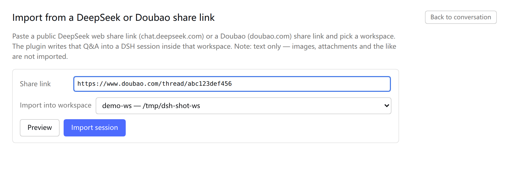

# dsh-share-import

[](https://github.com/Sillykjs/dsh-share-import/actions/workflows/ci.yml)
[](LICENSE)
[](#环境要求)

把一个**公开对话分享链接**导入成 [DeepSeek Harness (DSH)](https://github.com/deepseek-ai/dsh) 里的一个真实会话，落在你自己选的工作区里。目前支持两种来源：

- **DeepSeek** — `https://chat.deepseek.com/share/<id>`
- **豆包（Doubao）** — `https://www.doubao.com/thread/<id>`（也接受不带 `www` 的 `https://doubao.com/thread/<id>`）

导入的是**静态历史**：不发消息、不开 turn、不生成任何内容。打开就是一段已完成对话；你之后再提问时，这段历史自然成为上下文。

[English](README.md)

## 特性

- **零凭据**。DeepSeek 走公开分享接口 `https://chat.deepseek.com/api/v0/share/content?share_id=…`；豆包先走公开 JSON 快照接口（普通 ID `POST /alice/message/share/get`，`x` 开头的移动端分享 `POST /im/message/share/get`），拿不到再退回分享页 SSR HTML。不需要登录、不需要 token、不需要浏览器。
- **可选工作区**。导入前从当前 DSH 实例的工作区列表里挑一个，会话落在该工作区的路径下。
- **静止导入**。直接写 v4 会话事件：`session/title → turn/start → step/start → user/message → assistant/message → step/end → turn/end → session/end-seed`，不会调度任何生成。
- **去重保护**。同一个分享第二次导入默认被拦下（`ALREADY_IMPORTED`），面板提供「作为新会话再导一次」的显式路径。
- **中英双语 UI**。文案跟随 DSH 的界面语言。
- **可选导航入口**。设置页开关控制侧边栏是否出现该入口，状态存在当前浏览器的 `localStorage`。
- **不吹牛**。豆包分享只导入文字问答，图片和视频没有正文只会留一行占位说明；页面自己声明懒加载、且 JSON 快照也取不到时报 `SHARE_LAZY`，不会静默导入残缺会话。

## 截图

从侧边栏入口或 设置 → **分享导入** 打开的导入面板：



## 环境要求

- DSH **0.2.1-rc.2**（本插件编写与测试所用的版本）与 `web` profile。
- 运行 `dsh web` 的机器上 Node.js **≥ 20**。
- 一个无需登录即可打开的公开分享链接；私有/已删除的分享无法导入。

host 半依赖的 DSH 服务不是稳定的公开 API，DSH 升级后可能需要跟着适配。

## 安装

### 从 GitHub 安装（推荐）

```bash
dsh plugin --profile web add github:Sillykjs/dsh-share-import
```

`dsh plugin` 会把参数原样转给 profile 目录里的 `pnpm add`，所以其它 pnpm 规格也可以：

```bash
# 固定到某个 tag / 提交
dsh plugin --profile web add github:Sillykjs/dsh-share-import#v0.2.0
# 直接用 git URL
dsh plugin --profile web add git+https://github.com/Sillykjs/dsh-share-import.git
```

发布到 npm 之后：

```bash
dsh plugin --profile web add dsh-share-import
```

### 从本地仓库安装

```bash
git clone https://github.com/Sillykjs/dsh-share-import.git
cd dsh-share-import
dsh plugin --profile web add link:"$PWD"
```

`dsh plugin add` 会把 `dsh-share-import` 写进 profile 的 `dsh.profile.bundles`，[`cordis.patch.yml`](cordis.patch.yml) 里的 `insert` 负责把插件挂上。装完：

- **client 半**：刷新页面即可（宿主会在 ~500ms 内重新下发浏览器 bundle）。
- **host 半**：**重启承载 `dsh web` 的进程**。DSH 0.2.1-rc.2 没有进程内重载 host 插件代码的入口，改完 `lib/*.js` 只刷新页面没有任何效果。

## 使用

1. 侧边栏「全局面板」导航区点 **分享导入**（第三个入口，下载箭头图标）；也可以从设置（账号菜单 → Settings / 设置 → **分享导入**）进入同一个表单。
2. 设置页顶部的开关 **在导航区显示入口** 控制侧边栏是否出现该入口（默认开；关闭后设置页入口仍在）。状态存在浏览器 `localStorage` 的 `dsh-share-import:show-nav` 键。
3. 粘贴分享链接，选工作区。
4. **预览** 先确认标题、轮数、首末问题；确认后点 **导入会话**。
5. 成功后面板显示新会话 id，侧边栏自动刷新，标题即为该对话的首个问题。面板右上角 **回到对话** 退回当前会话。

同一个分享第二次导入默认会被拦下；需要重复导入时，面板会把按钮换成「作为新会话再导一次」。

## 导入内容与语义边界

| 项 | 行为 |
|---|---|
| 内容 | 只要问答正文（用户提问 + 助手回答）。思考过程、网页检索结果、打开过的页面、引用标记都不进会话。 |
| DeepSeek 分享 | 公开 JSON 分享接口 → 消息片段（`REQUEST` / `RESPONSE`）。 |
| 豆包分享 | 先调公开 JSON 快照接口（普通 ID `/alice/message/share/get`，`x` 开头的移动端分享 `/im/message/share/get`），失败再退回分享页 SSR `data-fn-args` 里的 `share_info` + `message_snapshot`。只收文字块（`block_type 10000`）；图片（`2074`）和视频/富媒体（`10050`）没有正文，若一条消息只有媒体，会以一行占位说明保留（`（这条消息在豆包网页端只有图片或视频，没有文字）`）。页面声明懒加载且 JSON 快照也取不到时，报 `SHARE_LAZY`，不导入残缺会话。 |
| 末尾悬空提问 | 若最后一条是「问而无答」，该提问会被丢弃，保证会话里没有未闭合的 turn。 |
| 标题 | 取首个用户提问，超过 80 字节按 UTF-8 边界截断；豆包分享若以助手消息开头，改用分享标题。 |
| 生成 | 不调用 `session.prompt`，导入完不会自动跑、也不会显示「生成中」。 |
| 沙箱/规划模式 | 不自动设置，沿用你当前的默认访问模式。 |
| 去重记录 | `$DSH_HOME/share-import/index.json`，键为 `source:id`（`deepseek:<id>` / `doubao:<id>`），值为 `{sessionId,title,importedAt}`。 |
| 会话文件 | `$DSH_HOME/sessions/<工作区编码>/<sessionId>/session.v4.jsonl.zstd`，由 `sessionPersistence` 写入并读回校验。 |

## 错误码

`SHARE_LINK_INVALID` · `SHARE_NOT_FOUND` · `SHARE_FETCH_FAILED` · `SHARE_MALFORMED` · `SHARE_EMPTY` · `SHARE_LAZY` ·
`ALREADY_IMPORTED` · `WORKSPACE_REQUIRED` · `WORKSPACE_UNKNOWN` · `WORKSPACES_UNAVAILABLE` ·
`PERSISTENCE_UNAVAILABLE` · `WRITE_FAILED` · `VERIFY_FAILED` · `INTERNAL`

## 隐私与安全

- 只访问两个公开分享域名（`chat.deepseek.com`、`www.doubao.com`），用匿名 GET/POST；不读 cookie、token 或 DSH 凭据。
- 只写两处：选定工作区下的 v4 会话文件，以及上面的去重记录。无遥测、无后台请求、无统计。
- 抓取的 URL 只由校验过的 id 拼出，拒绝重定向（`redirect: 'error'`），响应体有大小上限。
- 导入内容就是分享里的原文，请当作不可信文本使用，和你手动粘贴一段对话等价。

## 工作原理

```text
公开分享链接
  → POST /__dsh-share-import/preview   校验 → 抓取 → 规范化 → importableMessages → completeConversation
  → POST /__dsh-share-import/import    写入并读回校验（buildStaticSessionEvents）→ 预热投影缓存
                                       → workspace.attachSession(id)（带重试）→ 记录去重
  → client 调 sessions.refresh()        侧边栏出现新会话
```

host 半在 DSH web server 上注册三条 POST 路由（`/__dsh-share-import/{workspaces,preview,import}`）；client bundle 通过页面 fetch 调用。事件不变量由 smoke 测试断言：`seq` 从 0 连续、`time` 单调不减、`step/start` 先于承载它的 surface 事件、`surfaceOp` 只出现在 surface 类型上、最后一条是 `session/end-seed`、不留 open turn。

```
lib/index.js        host 半：路由、去重、写会话、挂工作区、预热投影缓存
lib/share.js        双来源链接解析、GET 文本 / POST JSON 出网、分发到对应读者
lib/doubao.js       豆包读者：JSON 快照（x 分享的 im 路由、消息块、秒级时间戳）与 SSR data-fn-args
lib/errors.js       两个读者共享的 ShareError（share.js 再导出）
lib/events.js       消息 → v4 会话事件（静态导入变体）
lib/formats.js      会话格式版本探测与 header 构造        ← 移植，见 NOTICE.md
lib/persistence.js  写会话 + 读回校验的兼容封装           ← 移植，见 NOTICE.md
lib/client.js       client bundle：侧边栏导航入口 + 主面板 + 设置分区
test/smoke.mjs      冒烟自测（纯逻辑默认跑，联网部分需自备分享链接）
```

## 开发与自测

```bash
node --check lib/index.js lib/share.js lib/doubao.js lib/errors.js lib/events.js \
  && node --check lib/formats.js lib/persistence.js lib/client.js
node test/smoke.mjs                                  # 纯逻辑断言（不联网）
DSH_SHARE_LINK='https://chat.deepseek.com/share/…' node test/smoke.mjs   # 追加真实拉取（也接受豆包链接）
```

隔离实例（不影响正在运行的 web 进程）：

```bash
DSH_HOME=/tmp/dsh-si-home dsh plugin --profile web add link:"$PWD"
DSH_HOME=/tmp/dsh-si-home dsh --profile web --host 127.0.0.1 --port 3099 --no-open
```

项目**零构建、零运行时依赖**：`lib/client.js` 就是浏览器 bundle 本身，host 半是 Cordis 直接加载的 ESM。请保持这个前提（完整维护说明见 [AGENTS.md](AGENTS.md)）。

## 常见问题

| 现象 | 原因 / 处理 |
|---|---|
| 装完看不到导航入口或面板 | 先刷新页面；确认 profile 里确实装上了（`dsh plugin --profile web why dsh-share-import`）。裸的 `/plugins/dsh-share-import/client.js`（不带 `?rev=`）**本来就该 404**，请用带 `?rev=` 的地址或 Plugins 事件流确认下发的 bundle。 |
| 改了 host 半没效果 | 重启 `dsh web` 进程。刷新只会重新加载 client bundle。 |
| `SHARE_LAZY` | 分享页声明了懒加载，且 JSON 快照没拿到消息。常见于服务端要求会话的移动端/`x…` 分享，暂不支持。 |
| `SHARE_NOT_FOUND` | 分享已删除、已过期、转为私有，或 id 写错。 |
| 侧边栏标题显示 Untitled | 投影缓存没预热（旧版本）。用当前版本即可，导入后会主动预热。 |

## 许可与归属

MIT，见 [LICENSE](LICENSE)。`lib/formats.js`、`lib/persistence.js` 移植自 [deepseek-web-import](https://www.npmjs.com/package/deepseek-web-import) v0.2.1（Copyright (c) 2026 wpc0323, MIT），详见 [NOTICE.md](NOTICE.md)；其余为本插件自写。

这是非官方社区插件，与 DeepSeek、字节跳动均无隶属关系。
